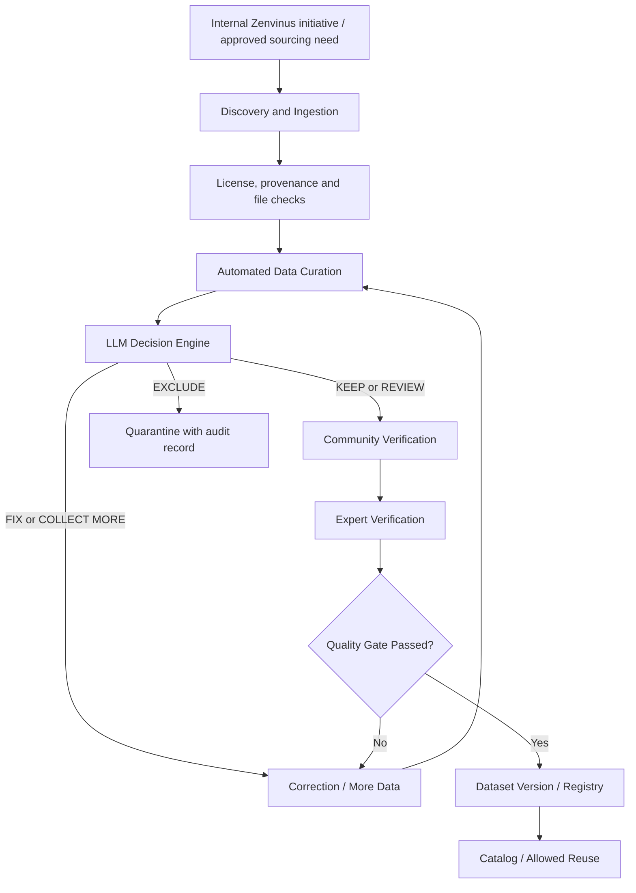
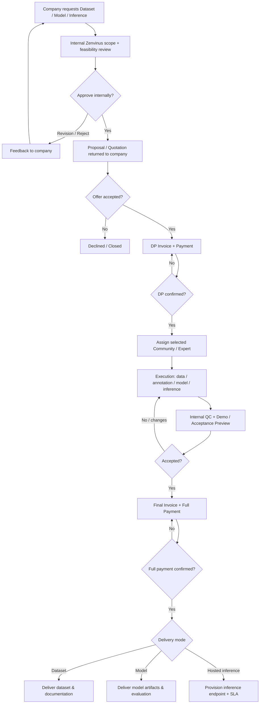
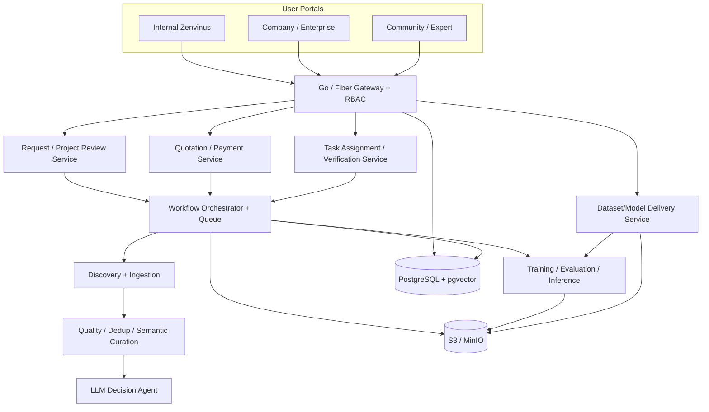

# ZENVINUS — Community & Enterprise Workflows (v3)

Updated: 18 October 2026

## A. Community data pipeline

**Intent**: Zenvinus or an approved contributor initiates a data collection or dataset project, particularly for public-interest problems in Indonesia. Automated discovery/curation suggests what to keep, fix, exclude or source again. Community and expert review validate outputs. This community track does not inherently involve a company payment milestone.

## B. Company / Enterprise project pipeline

**Commercial gate**: the agreed DP is received before work starts. Full payment is verified before unrestricted delivery / production access. Internal QC and a restricted preview can happen before final payment to support acceptance, without releasing the final assets.

## C. Shared technical architecture

## D. Role & authority boundaries

| Role | Actions | Authority |
|---|---|---|
| Internal Zenvinus | Initiates Indonesia-focused work; reviews enterprise requests; prepares quotations; oversees project and quality | Approves project initiation, assignments, internal release criteria |
| Company / Enterprise | Submits requirements, accepts offer, pays DP and balance, reviews acceptance preview | Controls private data sharing and acceptance/delivery terms |
| Community | Collects/annotates/fixes authorized data and verifies curation suggestions | Can recommend corrections; cannot unilaterally publish enterprise data |
| Expert | Validates difficult data, resolves review conflicts, executes specialist work | Expert quality judgment according to assigned permissions |
| LLM Decision Engine | Suggests KEEP, FIX, EXCLUDE, COLLECT_MORE with evidence and confidence | No payment approval, source-right approval, or irreversible deletion |

## E. Core state machines

Community: `SOURCING → INGESTED → CURATING → AI_RECOMMENDED → COMMUNITY_REVIEW → EXPERT_REVIEW → QC_APPROVED → VERSIONED` with `CORRECTION_REQUIRED` and `QUARANTINED` paths.

Enterprise: `REQUESTED → INTERNAL_REVIEW → QUOTED → OFFER_ACCEPTED → DP_PENDING → DP_CONFIRMED → IN_PROGRESS → INTERNAL_QC → AWAITING_FINAL_PAYMENT → FULLY_PAID → DELIVERED` with `REVISION_REQUIRED`, `REJECTED`, `CANCELLED`, `REWORK_REQUIRED` paths. For hosted inference: `DELIVERED → INFERENCE_ACTIVE`, subject to the contract and SLA.

## F. Essential safeguards

- Keep raw originals immutable and maintain dataset/version provenance; do not permanently auto-delete material on an LLM recommendation.
- Record source license and usage rights. Public catalog access requires sufficient rights; internet availability does not imply permission to copy or redistribute.
- Enterprise assets are private by default. Selected Community/Expert members get project-scoped access, per permission/NDA/consent.
- Persist proposal versions, accepted terms, DP and final payment confirmations, project acceptance and handover audit logs. Verify payment server-side.
- Ensure dataset/model evaluations have explicit acceptance criteria and avoid train/validation/test leakage.
- Deliverables can be `DATASET`, `MODEL`, `INFERENCE_API`, or combinations thereof; define each in the accepted proposal.
- For hosted inference, final payment may be an initial implementation milestone, followed by recurring hosting/usage charges only if agreed in the contract.

## G. Suggested MVP implementation order

1. Request intake, internal review and quotations, with DP/final payment lifecycle.
2. Project/task assignment and Community/Expert verification dashboards.
3. Ingestion, curation processor, decision recommendation, and approved dataset versions.
4. Model workbench, evaluation, and private artifact delivery / endpoint provisioning.
5. Discovery automation, reporting, SLAs and enterprise capacity scaling.
